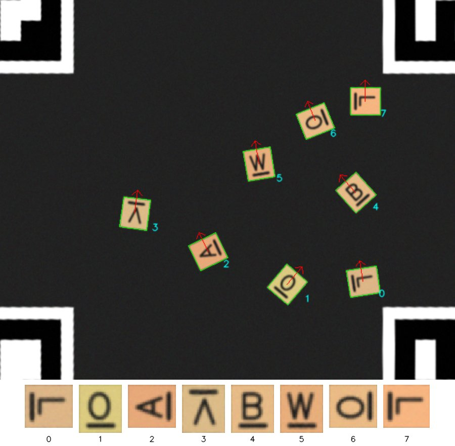

# Detección de fichas (etapa 2) — clásico vs DL

Garai (Equipo 9). Es la etapa 2 de [`PLAN_FICHAS.md`](PLAN_FICHAS.md): a partir de la bandeja enderezada,
encontrar cada ficha y dar su **centro (mm)**, el **ángulo de sus bordes** y un **recorte alineado** con ella,
que es lo que usa la etapa 3 (letras). Hay dos versiones que devuelven exactamente lo mismo.

| | Fichero |
|---|---|
| Detección (clásico y DL) | `ros_workspace/src/signos_fichas/signos_fichas/deteccion.py` |
| Evaluación de la etapa | `ros_workspace/src/signos_fichas/signos_fichas/evaluar_deteccion.py` |
| Tests | `ros_workspace/src/signos_fichas/test/test_deteccion.py` |
| Dataset de YOLO | `herramientas/fichas/dataset_yolo.py` |



## Qué devuelve (contrato con la etapa 3 y el nodo)

```python
from signos_fichas.deteccion import detectar_clasico, detectar_dl, theta_en_bandeja
fichas = detectar_clasico(enderezada)          # o detectar_dl(enderezada)
# [{'x': mm, 'y': mm, 'angulo': rad, 'recorte': imagen BGR, 'confianza': 0..1}, ...]
```

- `enderezada` es la salida de `bandeja.enderezar` con `px_por_mm = 2` (por defecto). Si se cambia, hay que pasar el
  mismo `px_por_mm` a la detección.
- `x`, `y`: centro de la ficha en mm de la bandeja (origen en el centro del ArUco 0, +X hacia el 1, +Y hacia el 2).
- `angulo`: hacia dónde apunta el "arriba" del recorte, en rad desde +X de la bandeja. De los 4 lados de la ficha se
  elige el que mira más hacia −Y, así que siempre está entre −135° y −45° y **el recorte se ve como en la enderezada,
  girado menos de 45°**.
- `recorte`: la ficha sola, con sus bordes rectos y 0,5 mm hacia dentro para que no entre fondo oscuro (unos 34 × 38 px
  a 2 px/mm).
- `confianza`: 1.0 en el clásico y la de YOLO en el DL. Es un extra sobre el contrato de `PLAN_FICHAS.md`: el nodo
  puede multiplicarla por la de la letra.

**Giro y theta.** La etapa de letras devuelve el giro `k` (0..3) tal que `np.rot90(recorte, k)` deja la letra
derecha (con la raya abajo). Entonces la theta del contrato (dirección raya → parte de arriba de la letra) es
`theta_en_bandeja(angulo, k)` = `angulo + k·90°`. Ejemplo: si en el recorte la letra tiene la parte de arriba
hacia la derecha, `k = 1` (`np.rot90` gira en sentido antihorario). El test `test_recorte_y_giro_dan_la_theta_real`
comprueba este convenio con la verdad de las sintéticas.

**Pista para la etapa de letras**: la letra va a lo largo del lado de 20 mm, así que si el recorte es más alto que
ancho el giro es 0 o 2, y si es más ancho que alto, 1 o 3. En las sintéticas acierta en 480 de 480 fichas (con al
menos 3 px de diferencia), pero hay que confirmarlo con las fichas reales antes de fiarse.

## Método clásico (solo OpenCV)

La bandeja es negra mate y las fichas de madera clara, así que la diferencia de **brillo** basta para separarlas.

1. **Brillo**: canal V de HSV (el máximo de B, G y R). No se usa el tono, para no depender del color exacto de
   la madera ni de la luz.
2. **Fuera los ArUco**: los marcadores y su papel blanco también son claros. Se quita un cuadrado de
   `LADO_ARUCO_MM / 2 + MARGEN_ARUCO_MM` (40 + 10 mm) alrededor del centro de cada uno; ahí no puede haber fichas.
3. **Umbral de Otsu** sobre el resto. Si no hay fichas, Otsu partiría el ruido del fondo en dos, así que se exige
   además que el umbral esté al menos `CONTRASTE_MIN` (40 niveles) por encima de la mediana, que es el fondo.
4. **Apertura** 3 × 3 para quitar puntos sueltos y **`findContours` externos**: los agujeros de la letra no importan.
5. **Filtro de forma** con `minAreaRect`: lados a ±4 mm de 18 × 20 mm y el contorno tiene que llenar al menos el
   85 % del rectángulo. Así se descartan los brillos, los trozos de papel y dos fichas que se tocan.
6. `minAreaRect` da el centro y el ángulo, y `warpAffine` saca el recorte alineado.

Los umbrales están al principio de `deteccion.py` y hay que ajustarlos con las fotos reales.

## Método DL (YOLO + refinado dentro de la caja)

1. **YOLO11n** (ultralytics) con una sola clase, `ficha`, sobre la enderezada (`imgsz = 640`). Da una caja recta y la
   confianza de cada ficha.
2. **Refinado** (`refinar_cajas`): dentro de cada caja, ampliada 3 mm, Otsu local y `minAreaRect` del contorno más
   grande, con el mismo filtro de forma que el clásico. La caja de YOLO no tiene ángulo, y el robot lo necesita para
   coger la ficha y dejarla derecha.

Por qué no YOLO con cajas orientadas (OBB): la ficha es casi cuadrada, y la pérdida de OBB (ProbIoU) apenas cambia
con el ángulo de un cuadrado, así que el ángulo se aprende mal. Además el giro de 90° lo resuelve la etapa de letras.

**Dataset** (`herramientas/fichas/dataset_yolo.py`), en formato de ultralytics y siempre con enderezadas:
- *Sintéticas*: las cajas salen de la verdad de `sinteticas.py`. Sirven para probar todo ya y para preentrenar.
- *Fotos reales* (`--fotos`): las cajas las propone `detectar_clasico` y se guardan dibujadas en `revisar/`. Hay que
  revisarlas a mano y quitar o corregir las malas antes de entrenar. Es más rápido que etiquetar desde cero y no
  necesita SAM, pero no sirve para el conjunto de test (si no, el DL aprendería los errores del clásico).
- *Compuestas* (`--fotos ... --compuestas N`, con `compuestas.py`): de cada foto real se sacan el fondo sin fichas
  (`cv2.inpaint`) y las fichas sueltas con su silueta, y se pegan al azar, giradas, con sombra y con otra luz
  (exposición, degradado, color, enfoque, ruido, JPEG y velo). Las cajas salen de dónde se pega cada ficha, así que
  hay muchas imágenes reales distintas sin etiquetar nada a mano. Con los vídeos del 23-11: 4000 en `train` y 500
  en `val`.
- `--min-aruco 1` deja usar fotos donde solo se ve un ArUco, como las del 23-11.
- La validación se separa por vídeo: cada llamada añade a `train` o a `val`.

**Entrenamiento** (desde la raíz del repo, mejor con GPU):

```bash
export PYTHONPATH=ros_workspace/src/signos_fichas
python3 herramientas/fichas/dataset_yolo.py ros_workspace/datasets/fichas --sinteticas 300 --semilla 10000
python3 herramientas/fichas/dataset_yolo.py ros_workspace/datasets/fichas --sinteticas 60 --semilla 20000 --split val
yolo detect train data=ros_workspace/datasets/fichas/data.yaml model=yolo11n.pt imgsz=640 epochs=40 project=runs
mkdir -p ros_workspace/modelos && cp runs/train/weights/best.pt ros_workspace/modelos/yolo_fichas.pt
```

`detectar_dl` busca los pesos en `~/ros_workspace/modelos/yolo_fichas.pt` (dentro del contenedor, la carpeta
`ros_workspace/modelos/` del repo) o en el parámetro `modelo`. Los pesos y los datasets no van a git (`.gitignore`):
se suben a la carpeta del grupo en Drive.

## Evaluación

`evaluar_deteccion.py` pasa los dos métodos por imágenes con su verdad (el `.json` de `sinteticas.py`, o el mismo
formato para fotos reales), empareja cada ficha real con la detección más cercana (a 5 mm como mucho) y mide las
fichas perdidas y falsas, el error del centro, el del ángulo de los bordes (módulo 90°) y el tiempo de la detección.

```bash
python3 -m signos_fichas.sinteticas /tmp/test_fichas --n 50 --semilla 2000
python3 -m signos_fichas.evaluar_deteccion /tmp/test_fichas --metodo clasico dl --dibujos /tmp/dibujos
```

**Resultados con sintéticas** (50 imágenes de test, 400 fichas; semillas 2000-2049, que no se usan para entrenar).
YOLO11n entrenado en CPU con 300 sintéticas (semillas 10000+) y validado con 60 (20000+). Se paró en la época 16
(unos 20 min) porque la validación ya daba precisión y recall de 1 y mAP50 de 0,995. Tiempos en CPU (portátil,
16 hilos):

| Método | Fichas | Perdidas | Falsas | Error del centro (mm), media / máx | Error del ángulo (°), media / máx | ms por imagen |
|---|---|---|---|---|---|---|
| Clásico | 400 | 0 | 0 | 0,20 / 0,37 | 0,22 / 2,31 | 3,5 |
| DL | 400 | 0 | 0 | 0,19 / 0,42 | 0,20 / 1,73 | 42,8 |

En las sintéticas los dos métodos son perfectos, así que **la comparación que importa es con fotos reales**
(B4 y B8): luz del laboratorio, sombras del robot, reflejos, otros objetos en la bandeja y fondos menos oscuros,
que es donde el DL debería aguantar mejor. Con una sombra fuerte simulada (la imagen multiplicada por una rampa de
0,2 a 1) los dos siguen sin fallar, porque el contraste madera/fondo es muy grande.

**Primeros resultados con fotos reales** (25-11): 13 fotos de la sesión del 23-11 en las que se ve el ArUco 2
(`--min-aruco 1`), con 100 fichas, de las que 34 tocan a otra. El DL es el YOLO de arriba, entrenado solo con
sintéticas. Tiempos en CPU:

```bash
python3 -m signos_fichas.evaluar_deteccion ros_workspace/datasets/fichas/test/2026-11-23 --metodo clasico dl \
    --min-aruco 1 --modelo ros_workspace/modelos/yolo_fichas.pt
```

| Método | Fichas | Perdidas (de ellas, juntas) | Falsas | Error del centro (mm), media / máx | Error del ángulo (°), media / máx | ms por imagen |
|---|---|---|---|---|---|---|
| Clásico | 100 | 38 (34) | 0 | — | — | 2,4 |
| DL | 100 | 49 (34) | 0 | 0,21 / 1,52 | 0,45 / 2,63 | 35,8 |

- La verdad de estas fotos se hizo partiendo de las cajas del clásico, así que su error sale 0 y no se pone; el del
  DL está medido respecto al clásico.
- Los dos pierden todas las fichas que se tocan (el clásico, a propósito). De las 66 separadas, el clásico pierde 4
  y el DL 15: el YOLO de sintéticas no basta con fotos reales, y por eso se ha hecho el dataset de compuestas.
- No sirven como test final: son de la misma sesión que los vídeos de las compuestas.

| | Clásico | DL |
|---|---|---|
| Qué hace falta | Bandeja oscura y fichas separadas | Fotos etiquetadas y entrenar |
| Ajuste | Umbrales a mano (`deteccion.py`) | Datos; el refinado sigue usando el contraste |
| Dependencias | Solo OpenCV | ultralytics + PyTorch (mejor con GPU) |
| Si falla | Se ve en qué paso (umbral, tamaño, forma) | Difícil de explicar |

## Probarlo con fotos

```bash
python3 -m signos_fichas.deteccion foto1.png foto2.png              # muestra lo detectado
python3 -m signos_fichas.deteccion fotos/*.png --metodo dl --salida dibujos
```

## Cómo ha ido el trabajo

Se ha trabajado por tardes, y cada tarde acaba en unos commits.

| Día | Qué se hizo |
|---|---|
| 19-11 | Xabat sube el diseño común (`CLAUDE.md`) y el reparto de tareas. |
| 23-11 | Fase 0 (paquetes y mensajes, Xabier). Primera sesión de laboratorio (18:27-18:52): 62 fotos y 6 vídeos de fichas. |
| 24-11 | Mikel integra `bandeja.py`, `sinteticas.py` y el plan de fichas (PR #3). Por la tarde: detección clásica y DL, evaluación, dataset de YOLO con sintéticas, primer YOLO y este documento (PR #7, 3 commits). |
| 25-11 | Paso a las fotos reales del 23-11: dataset de YOLO con un solo ArUco e imágenes compuestas, evaluación con 13 fotos reales y documentación (3 commits). |

- **Las fotos reales no son como el diseño.** No había bandeja (cartulina negra) y solo se ve el ArUco 2; las fichas
  son de Scrabble, de unos 20 × 22 mm, con un número pequeño y sin raya; hay letras A-G y L, pero no O, V ni W. Por
  eso el 25-11 se trabajó en usar un solo ArUco y en el dataset de compuestas.
- **El YOLO con compuestas aún no se ha entrenado**: en la GPU del portátil (RTX 3050 Ti en WSL) se cae WSL al
  empezar la primera época.

## Pendiente

- **Entrenar YOLO con las compuestas** y repetir la evaluación con fotos reales. En la GPU del portátil se cae WSL:
  hay que hacerlo en CPU (lento) o en otro PC.
- **Fotos de otra sesión** para el test final, con la bandeja y las fichas definitivas: las 13 de ahora son de la
  misma sesión que las compuestas.
- Confirmar con el grupo la ficha real (en las fotos, 20 × 22 mm y sin raya; en el diseño, 18 × 20 mm con raya) y
  ajustar `CONTRASTE_MIN`, `MARGEN_ARUCO_MM` y `TOLERANCIA_MM`.
- Decidir con la etapa de letras el `px_por_mm` de la enderezada: a 2 px/mm la letra mide unos 20 px de alto.
- Fichas que se tocan: ahora se descartan (el montaje garantiza una separación mínima). En las fotos del 23-11 se
  tocan 34 de 100.
